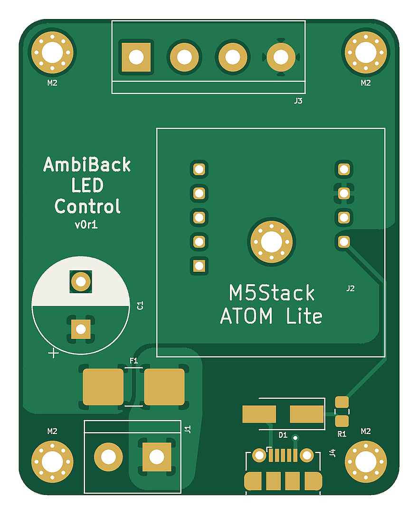
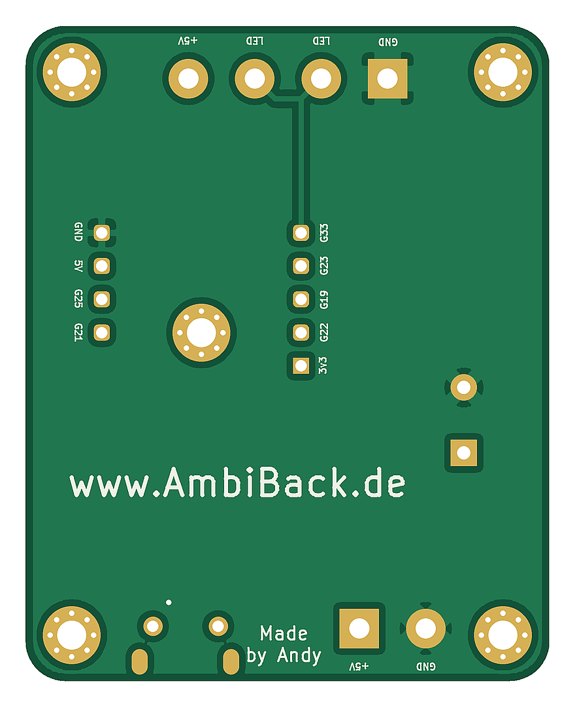

# AmbiBack Hardware

[English](README.md) · **Deutsch**

Platinendaten für das [AmbiBack-Projekt](https://github.com/ambiback). Die LED-Controller-Platine v0r1 nimmt einen M5Stack Atom Lite mit der [AmbiBack-Firmware](https://github.com/ambiback/ambiback-firmware) auf.

**Platinenentwurf:** [Andreas „Andy“ Hofmann](https://github.com/ezcGman), 2021, veröffentlicht mit seiner Zustimmung.

| Oberseite | Unterseite |
| --- | --- |
|  |  |

Die Bilder sind aus den Gerber-Dateien dieses Repositorys gerendert. Es sind keine Fotos, und die Farben zeigen keine echte Platine.

## Status

- Prototyp-Revision v0r1. Prüfe den Entwurf, bevor du Platinen bestellst.
- **Die Platine wurde nicht mit der aktuellen Firmware getestet.**
- **Abweichender LED-Datenpin:** Die Platine führt die LED-Daten auf `G33`, das Firmware-Ziel `ESP32_M5ST_ATOMLITE` nutzt standardmäßig GPIO 26. Für diese Platine muss `LEDCTRL_PIN` in `globalincludes.h` auf `33` geändert werden. Diese Änderung ist nicht getestet.
- AmbiBack-Geräte werden seit rund fünf Jahren nicht mehr verkauft. Dieses Repository dient dem Eigenbau, ohne Produktsupport. Mehr auf [ambiback.de](https://www.ambiback.de/).

## LED-Controller-Platine v0r1

- Größe: 40 × 50 mm
- Steckplatz für einen M5Stack Atom Lite
- 5-V-Stromversorgung über eine zweipolige Schraubklemme, mit Sicherung auf der Platine
- Vierpolige LED-Schraubklemme mit der Beschriftung `+5V`, `LED`, `LED`, `GND`
- Micro-USB-Buchse, die die Platine nicht versorgt. Ihre 5-V-Leitung führt über Diode und Widerstand als Signal `USB-CHK` auf einen Pin des Atom.

## Dateien

| Pfad | Inhalt |
| --- | --- |
| [`led-control-v0r1/kicad/`](led-control-v0r1/kicad/) | KiCad-5-Projekt |
| [`led-control-v0r1/gerber/`](led-control-v0r1/gerber/) | Gerber- und Bohrdateien für die Fertigung |
| [`images/`](images/) | Renderings beider Seiten |

Das Projekt nutzt Footprints aus [andys-footprints](https://github.com/ezcGman/andys-footprints). Lokale Dateipfade wurden aus der Netzliste entfernt, der Entwurf selbst ist unverändert.

## Lizenz

Copyright (C) 2021 Andreas Hofmann

Die Platinendaten und die daraus abgeleiteten Bilder stehen unter [Creative Commons Namensnennung – Nicht kommerziell – Weitergabe unter gleichen Bedingungen 4.0 International (CC BY-NC-SA 4.0)](https://creativecommons.org/licenses/by-nc-sa/4.0/deed.de), siehe [LICENSE.txt](LICENSE.txt). Eine kommerzielle Nutzung ist nicht erlaubt. Sie werden ohne Gewähr bereitgestellt.

M5Stack ist eine Marke ihres Inhabers und wird nur zur Beschreibung der Kompatibilität genannt. Dieses Projekt steht in keiner Verbindung zu ihr.
