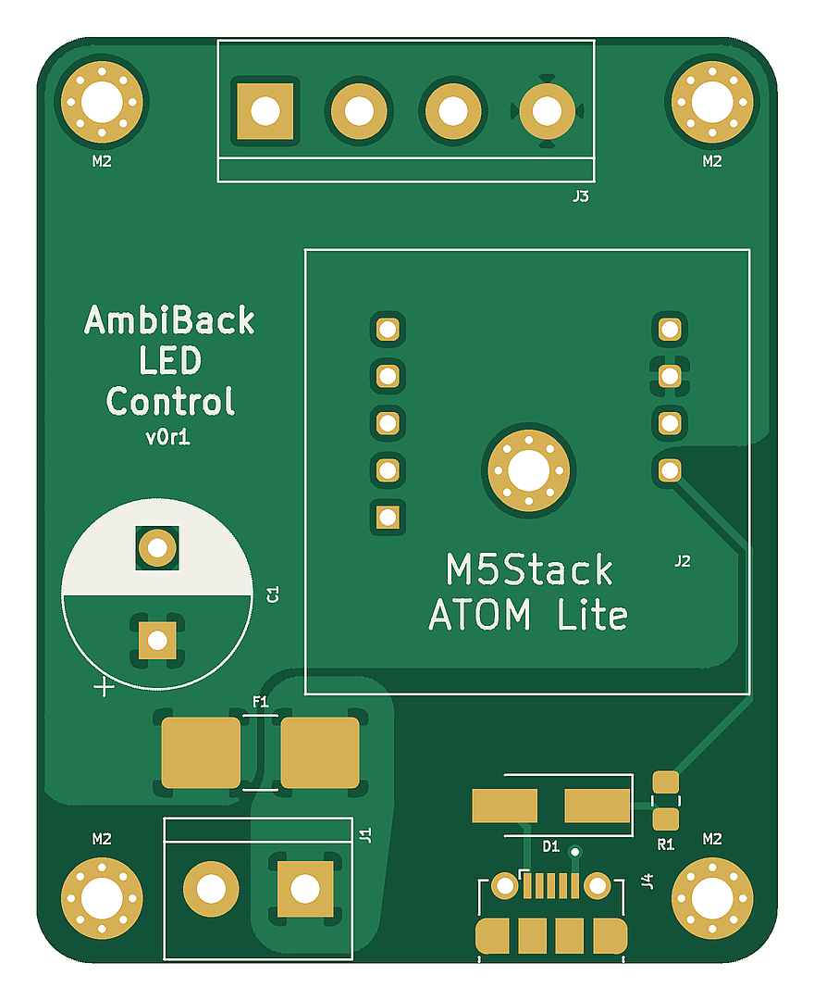
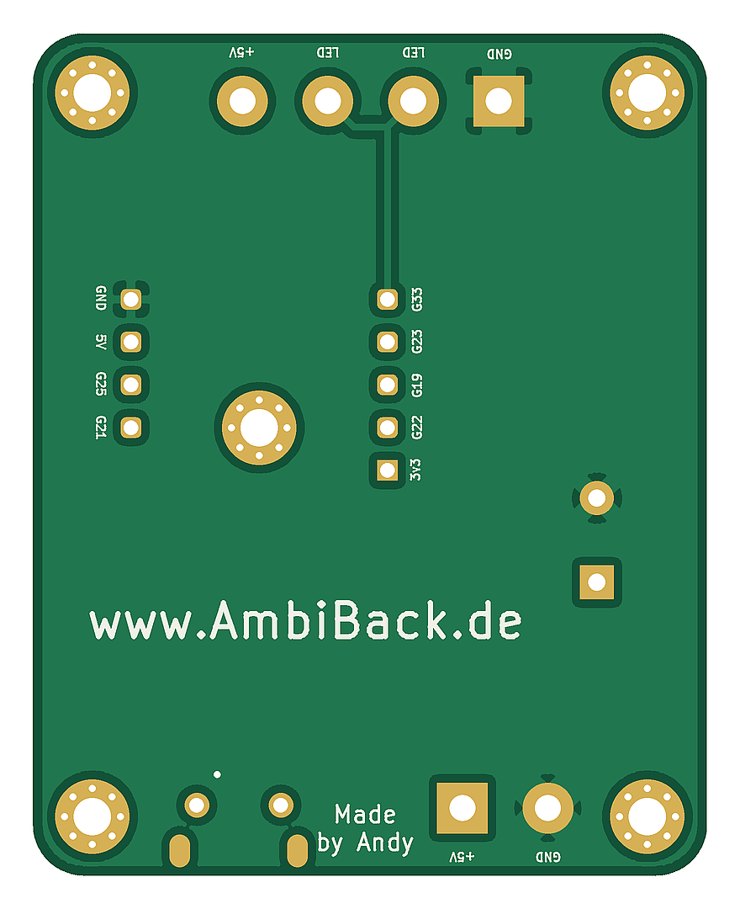

# AmbiBack Hardware

**English** · [Deutsch](README.de.md)

PCB design files for the [AmbiBack project](https://github.com/ambiback). The LED controller PCB v0r1 holds an M5Stack Atom Lite running the [AmbiBack firmware](https://github.com/ambiback/ambiback-firmware).

**PCB design:** [Andreas "Andy" Hofmann](https://github.com/ezcGman), 2021, published with his consent.

| Top | Bottom |
| --- | --- |
|  |  |

The images are rendered from the Gerber files in this repository. They are not photos, and the colors do not show a real board.

## Status

- Prototype revision v0r1. Review the design before ordering boards.
- **The board has not been tested with the current firmware.**
- **LED data pin mismatch:** The board routes LED data to `G33`, but the firmware target `ESP32_M5ST_ATOMLITE` uses GPIO 26 by default. With this board, `LEDCTRL_PIN` in `globalincludes.h` has to be changed to `33`. This change has not been tested.
- AmbiBack devices have not been on sale for around five years. This repository is for DIY use, with no product support. More at [ambiback.de](https://www.ambiback.de/).

## LED controller PCB v0r1

- Board size: 40 × 50 mm
- Socket for an M5Stack Atom Lite
- 5 V power input through a two-pin screw terminal, with a fuse on the board
- Four-pin LED screw terminal labeled `+5V`, `LED`, `LED`, `GND`
- Micro-USB socket that does not power the board. Its 5 V line reaches an Atom pin through a diode and resistor as the signal `USB-CHK`.

## Files

| Path | Content |
| --- | --- |
| [`led-control-v0r1/kicad/`](led-control-v0r1/kicad/) | KiCad 5 project |
| [`led-control-v0r1/gerber/`](led-control-v0r1/gerber/) | Gerber and drill files for manufacturing |
| [`images/`](images/) | Renderings of both sides |

The project uses footprints from [andys-footprints](https://github.com/ezcGman/andys-footprints). Local file paths were removed from the netlist. The design itself is unchanged.

## License

Copyright (C) 2021 Andreas Hofmann

The PCB data and the images derived from it are licensed under [Creative Commons Attribution-NonCommercial-ShareAlike 4.0 International (CC BY-NC-SA 4.0)](https://creativecommons.org/licenses/by-nc-sa/4.0/), see [LICENSE.txt](LICENSE.txt). Commercial use is not permitted. They are provided as is and without warranty.

M5Stack is a trademark of its owner and is named only to describe compatibility. This project is not affiliated with it.
